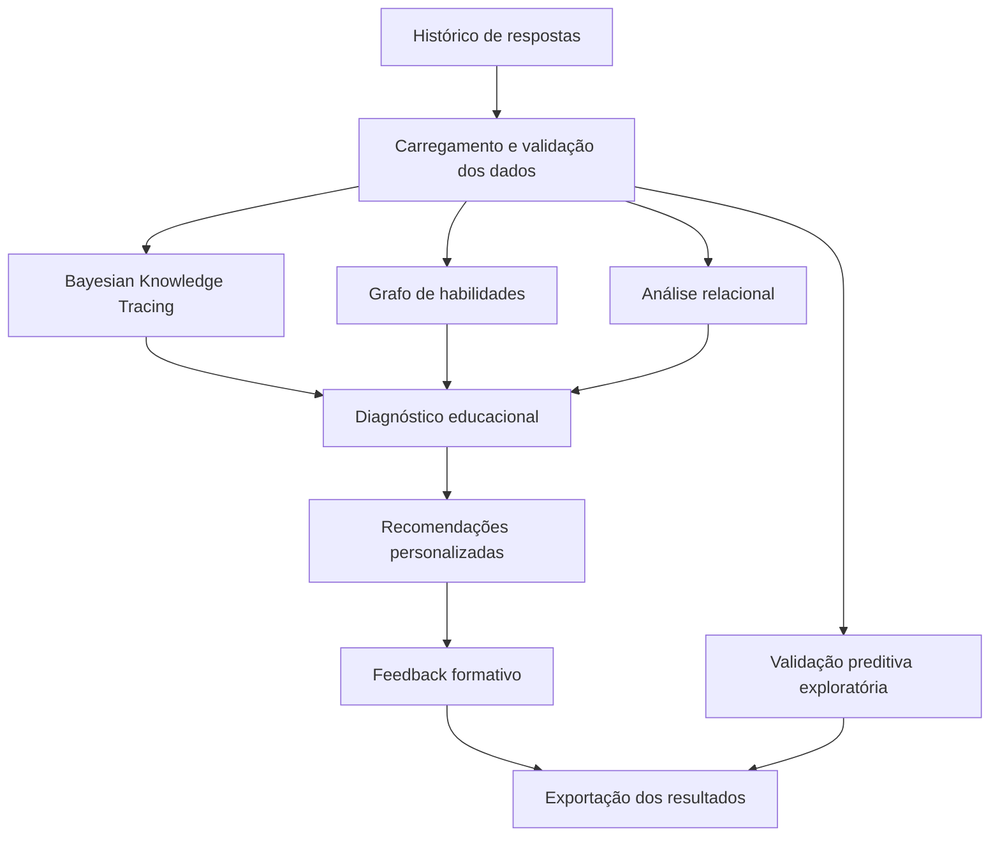
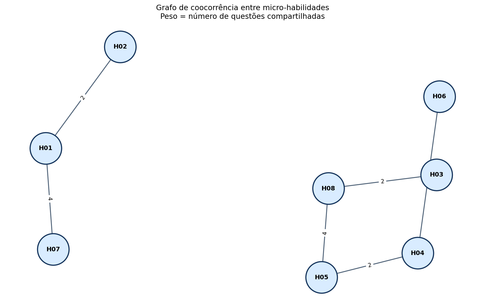

# Chagas MVP — Quanto este aluno sabe?


## 1. Sobre o projeto

Protótipo desenvolvido para o desafio técnico Chagas AI — "Quanto este aluno sabe?".
O projeto propõe uma abordagem computacional para estimar o domínio de micro-habilidades de estudantes de medicina, identificar possíveis dificuldades de aprendizagem e orientar recomendações personalizadas de estudo.
A solução integra modelagem probabilística, teoria dos grafos, análise relacional e feedback formativo, buscando transformar o histórico de respostas dos estudantes em informações interpretáveis e educacionalmente relevantes.
Os dados utilizados são fictícios e foram fornecidos no contexto do desafio técnico. As estimativas produzidas não constituem uma avaliação de competência clínica.

## 2. Objetivos

- Estimar probabilisticamente o domínio de cada micro-habilidade.
- Identificar relações entre habilidades presentes nas questões.
- Investigar possíveis dificuldades individuais e relacionais.
- Priorizar ações de estudo de acordo com as evidências observadas.
- Produzir feedback formativo personalizado.
- Comparar experimentalmente diferentes abordagens de previsão de desempenho.

## 3. Arquitetura da solução



A arquitetura modular permite separar as responsabilidades de cada componente, facilitando a interpretação, manutenção, reprodução e evolução do protótipo.

## 4. Estrutura do projeto

```text
chagas-mvp/
│
├── data/
│   ├── habilidades.csv
│   ├── questoes.csv
│   └── respostas.csv
│
├── src/
│   ├── bkt.py
│   ├── grafo.py
│   ├── analise_relacional.py
│   ├── diagnostico.py
│   ├── recomendacao.py
│   ├── feedback_formativo.py
│   ├── validacao.py
│   └── main.py
│
├── outputs/
│   └── Arquivos de resultados
│
├── tests/
│   └── test_algoritmos.py
│
├── .gitignore
├── requirements.txt
└── README.md
```

### Responsabilidades dos módulos

| Arquivo | Responsabilidade |
| --- | --- |
| `bkt.py` | Estimar o domínio probabilístico para todos os pares aluno–habilidade. |
| `grafo.py` | Construir o grafo de coocorrências e calcular a prioridade experimental. |
| `analise_relacional.py` | Comparar o desempenho em questões individuais e conjuntas. |
| `diagnostico.py` | Combinar evidências sem modificar as probabilidades estimadas pelo BKT. |
| `recomendacao.py` | Ordenar ações de estudo e apresentar suas justificativas. |
| `feedback_formativo.py` | Produzir feedback com observações, interpretações, ações e limitações. |
| `validacao.py` | Comparar previsões sequenciais de acerto com modelos estatísticos de referência. |
| `main.py` | Validar os dados e coordenar a execução dos módulos. |
| `test_algoritmos.py` | Executar testes unitários e de integração. |

## 5. Instalação e execução

### Pré-requisitos

- Python 3.10 ou superior;
- Git (opcional, para clonar o repositório);
- Dependências especificadas no arquivo `requirements.txt`.

Após baixar ou clonar o repositório, abra o terminal na pasta raiz do projeto.

Recomenda-se a utilização de um ambiente virtual para isolar as dependências.

### Linux

Crie e ative o ambiente virtual:

```bash
python3 -m venv .venv
source .venv/bin/activate
```

Instale as dependências:

```bash
python -m pip install -r requirements.txt
```

Execute o protótipo:

```bash
python src/main.py
```

### Windows (PowerShell)

Crie e ative o ambiente virtual:

```powershell
py -m venv .venv
.\.venv\Scripts\Activate.ps1
```

Instale as dependências:

```powershell
python -m pip install -r requirements.txt
```

Execute o protótipo:

```powershell
python src/main.py
```

Caso o PowerShell bloqueie a ativação do ambiente virtual, utilize diretamente o interpretador:

```powershell
.\.venv\Scripts\python.exe -m pip install -r requirements.txt
.\.venv\Scripts\python.exe src/main.py
```

### macOS

Crie e ative o ambiente virtual:

```bash
python3 -m venv .venv
source .venv/bin/activate
```

Instale as dependências:

```bash
python -m pip install -r requirements.txt
```

Execute o protótipo:

```bash
python src/main.py
```

> O ambiente de desenvolvimento e testes utilizado foi Linux. As instruções para Windows e macOS foram disponibilizadas para facilitar a reprodução do projeto, embora a execução nesses sistemas ainda não tenha sido verificada experimentalmente.

### Seleção de estudante

Por padrão, o terminal apresenta os resultados do estudante A03.
Para selecionar outro estudante, com o ambiente virtual ativo:

```bash
python src/main.py --aluno A01
```

Os resultados de todos os estudantes são exportados independentemente do estudante selecionado para exibição no terminal.

### Testes automatizados

Para executar os testes unitários e de integração:

```bash
python -m unittest discover -s tests -v
```

Caso esteja utilizando o interpretador diretamente no Windows:

```powershell
.\.venv\Scripts\python.exe -m unittest discover -s tests -v
```

O protótipo possui 10 testes automatizados.

### Personalização dos diretórios

Os argumentos `--data` e `--output` permitem indicar outros diretórios de entrada e saída.

```bash
python src/main.py --data data --output outputs
```

Os arquivos de dados originais são preservados durante a execução.

## 6. Fundamentação metodológica

### 6.1. Bayesian Knowledge Tracing (BKT)

O Bayesian Knowledge Tracing é utilizado como modelo probabilístico de estimativa do domínio individual de cada micro-habilidade.

O modelo atualiza a probabilidade de domínio a partir da sequência cronológica de respostas do estudante.

| Parâmetro | Descrição | Valor inicial |
| --- | --- | --- |
| P(L0) | Probabilidade inicial de domínio | 0,20 |
| P(T) | Probabilidade de aprendizagem | 0,05 |
| P(S) | Probabilidade de erro apesar do domínio | 0,10 |
| P(G) | Probabilidade de acerto sem domínio | 1 / número de alternativas |

Após cada resposta, aplica-se o teorema de Bayes para atualizar a crença de domínio. Em seguida, considera-se a possibilidade de aprendizagem:

$$
P(L') = P(L \mid resposta) + [1-P(L \mid resposta)]P(T)
$$

A estimativa representa o estado de conhecimento após a oportunidade de aprendizagem.
Os parâmetros utilizados constituem hipóteses iniciais e não valores calibrados empiricamente.
Somente questões sem habilidade secundária atualizam diretamente o BKT, evitando atribuir erros em questões conjuntas exclusivamente à habilidade principal.
Todas as tentativas dessas questões são preservadas em ordem cronológica.
Na ausência de observações individuais, retorna-se a probabilidade inicial de 0,20, identificada explicitamente como uma estimativa sem evidências observadas.

A coluna `taxa_acerto_observada` considera todas as tentativas em que a habilidade é principal, enquanto `taxa_individual` utiliza somente primeiras tentativas em questões isoladas.

### 6.2. Grafo de habilidades

As micro-habilidades são representadas como vértices de um grafo não direcionado.
As arestas representam a coocorrência de duas habilidades em uma mesma questão, e seus pesos correspondem à quantidade de questões compartilhadas.
A prioridade experimental de estudo é calculada por:

$$
Prioridade_i = (1-P_i)+0,25
\frac{\sum_{j \in N(i)}w_{ij}(1-P_j)}
{\sum_{j \in N(i)}w_{ij}}
$$

Onde:

- `P_i` representa o domínio estimado da habilidade analisada;
- `P_j` representa o domínio estimado de uma habilidade vizinha;
- `w_ij` representa o peso da relação;
- `N(i)` representa o conjunto de habilidades vizinhas.

Na ausência de vizinhos, a contribuição relacional é considerada nula.
A prioridade varia entre 0 e 1,25 e não representa uma probabilidade.
O grafo não modifica as estimativas produzidas pelo BKT e não estabelece relações causais ou pré-requisitos pedagógicos.
A prioridade é utilizada para ordenar ações individuais dentro de uma mesma etapa do plano de estudos.

### 6.3. Análise relacional

A análise relacional utiliza somente a primeira tentativa registrada de cada aluno em cada questão, tanto individual quanto conjunta.
Para um par de habilidades A e B, são consideradas:

- `a`: taxa de acertos em questões isoladas da habilidade A;
- `b`: taxa de acertos em questões isoladas da habilidade B;
- `c`: taxa de acertos em questões que envolvem ambas as habilidades.

A diferença de desempenho é calculada por:

$$
D = \frac{a+b}{2}-c
$$

Esse indicador permite investigar possíveis diferenças entre o desempenho individual e conjunto.
A análise utiliza os seguintes critérios exploratórios:

| Critério | Valor |
| --- | --- |
| Mínimo de questões isoladas distintas por habilidade | 4 |
| Mínimo de questões conjuntas | 2 |
| Desempenho alto | A partir de 70% |
| Desempenho baixo | Abaixo de 50% |
| Diferença relevante | A partir de 25 pontos percentuais |

Os resultados são classificados como possíveis dificuldades, desempenho atípico, desempenho favorável, resultado inconclusivo ou evidência insuficiente.
O indicador é descritivo e não constitui uma medida validada da capacidade de integração entre habilidades.

### 6.4. Diagnóstico educacional

O diagnóstico combina as estimativas probabilísticas, as taxas observadas e as evidências relacionais.

| Domínio estimado pelo BKT | Classificação |
| --- | --- |
| Abaixo de 40% | Baixo |
| De 40% a menos de 60% | Em desenvolvimento |
| De 60% a menos de 80% | Bom estimado |
| A partir de 80% | Elevado estimado |

Também são consideradas a quantidade de questões respondidas e possíveis divergências entre a estimativa probabilística e o desempenho observado.
Essas classificações são heurísticas iniciais, não critérios educacionais clinicamente validados.

### 6.5. Recomendações personalizadas

O plano de estudos é organizado em três etapas:

1. Revisão de fundamentos ou coleta de evidências adicionais.
2. Prática e investigação das relações entre habilidades.
3. Manutenção do conhecimento.

As atividades propostas são sugestões gerais associadas às micro-habilidades, não questões inéditas geradas automaticamente nem sequências de pré-requisitos causais.

### 6.6. Feedback formativo

Cada recomendação apresenta:

- Evidências observadas no histórico do estudante;
- Quantidade de acertos e questões analisadas;
- Identificação das questões respondidas incorretamente na primeira tentativa;
- Interpretação preliminar das dificuldades;
- Próxima ação de estudo;
- Identificação de questões ainda não respondidas, quando disponíveis;
- Limitações da interpretação.

Um relatório individual é exportado em Markdown para cada estudante.
Como o conjunto de dados não contém enunciados, alternativas selecionadas ou registros do raciocínio do estudante, o sistema não atribui erros conceituais específicos sem evidências suficientes.
A investigação conceitual adaptativa constitui uma possibilidade de evolução futura, mediante dados adicionais e participação de educadores.

## 7. Avaliação preditiva exploratória

A avaliação utiliza um protocolo sequencial (prequential), sem ajuste dos parâmetros aos resultados observados.
Para cada estudante e micro-habilidade, as questões isoladas são organizadas cronologicamente.
A avaliação começa após pelo menos três questões distintas anteriores e considera somente a primeira tentativa registrada de cada nova questão.
O histórico disponível contém todas as tentativas individuais anteriores, inclusive repetições, para os três modelos avaliados.
Respostas com o mesmo timestamp são previstas antes de qualquer atualização daquele lote, evitando vazamento temporal de informações.
O objetivo da avaliação é prever o acerto em uma questão individual ainda não respondida pelo estudante, e não validar diretamente sua probabilidade latente de domínio.

### Modelos comparados

**Taxa acumulada suavizada**

$$
P(acerto)=\frac{1+acertos}{2+tentativas}
$$

**Média móvel suavizada**

Utiliza a mesma expressão da taxa acumulada, considerando somente as três últimas tentativas.

**Bayesian Knowledge Tracing**

$$
P(acerto)=P(L)(1-P(S))+(1-P(L))P(G)
$$

O estado de domínio é atualizado somente a partir das respostas anteriores ao evento previsto.

### Métricas de avaliação

- **Brier Score:** erro quadrático médio das probabilidades previstas.
- **Log Loss:** penalização de previsões probabilísticas incorretas.
- **Acurácia:** proporção de classificações corretas, utilizando o limiar de 0,5.
- **Calibração:** comparação descritiva entre probabilidades previstas e frequências observadas em cinco intervalos fixos.

### Resultados experimentais

Foram avaliados 265 eventos de previsão comuns aos três modelos, utilizando os dados fictícios fornecidos.

| Modelo | Brier Score | Log Loss | Acurácia |
| --- | ---: | ---: | ---: |
| Taxa acumulada | 0,237612 | 0,672364 | 62,26% |
| Média móvel | 0,236981 | 0,670011 | 62,26% |
| BKT | 0,254438 | 0,726509 | 59,62% |

Valores menores de Brier Score e Log Loss indicam melhor desempenho preditivo.
A média móvel apresentou as menores perdas neste protocolo, com pequena diferença em relação à taxa acumulada.
O BKT, utilizando parâmetros fixos, não superou os modelos estatísticos de referência.
Sua utilização no protótipo permanece associada à hipótese de representação interpretável do domínio latente e da evolução do conhecimento, e não a uma superioridade preditiva demonstrada.
Para previsão de acertos, a média móvel constitui a referência provisória mais promissora neste experimento.
Uma eventual adoção do BKT em produção exigiria calibração dos parâmetros em dados separados e avaliação independente.
A avaliação realizada não demonstra benefícios pedagógicos do grafo, do feedback formativo ou das recomendações personalizadas.

## 8. Resultados gerados

A execução do protótipo produz:

| Indicador | Quantidade |
| --- | ---: |
| Estudantes analisados | 12 |
| Micro-habilidades | 8 |
| Questões | 80 |
| Registros de respostas | 665 |
| Estimativas individuais de domínio | 96 |
| Arestas do grafo | 6 |
| Análises relacionais | 72 |
| Diagnósticos individuais | 96 |
| Recomendações | 136 |
| Relatórios individuais | 12 |
| Eventos de previsão comparados | 265 |

### Arquivos de saída

| Arquivo | Conteúdo |
| --- | --- |
| `estimativas_bkt_grafo.csv` | Estimativas de domínio, prioridades e quantidades de tentativas. |
| `arestas_grafo.csv` | Relações entre habilidades e questões associadas. |
| `grafo_habilidades.png` | Representação visual do grafo. |
| `desempenho_relacional.csv` | Taxas individuais e conjuntas, diferenças e classificações preliminares. |
| `diagnostico_alunos.csv` | Indicadores individuais e alertas relacionais. |
| `recomendacoes.csv` | Plano de estudos ordenado, ações e justificativas. |
| `feedback_formativo.csv` | Evidências, interpretações, ações e limitações. |
| `feedback_alunos/` | Relatórios individuais em Markdown. |
| `previsoes_validacao.csv` | Previsões individuais e resultados observados. |
| `metricas_validacao.csv` | Métricas comparativas dos modelos. |
| `calibracao_validacao.csv` | Análise descritiva de calibração. |

Os arquivos CSV utilizam separador por vírgula e codificação UTF-8 com BOM.

As probabilidades e taxas são representadas na escala de 0 a 1. Campos de taxa vazios representam ausência de observações, e não zero acertos.

### Visualização das relações entre micro-habilidades



## 9. Testes automatizados

O protótipo possui 10 testes unitários e de integração, contemplando:

- Verificação do cálculo probabilístico do BKT;
- Comportamento da probabilidade inicial;
- Separação entre questões individuais e conjuntas;
- Identificação da primeira tentativa;
- Critérios de classificação;
- Execução integrada do protótipo;
- Previsão de acertos;
- Prevenção de vazamento temporal;
- Cálculo das métricas de avaliação.

Os testes verificam o funcionamento computacional do software, não sua validade educacional.

## 10. Limitações

- O BKT não utiliza diretamente questões conjuntas para atualizar o domínio individual, perdendo parte da informação em favor de uma atribuição mais transparente.
- Os parâmetros probabilísticos são fixos e ainda não foram calibrados empiricamente.
- O BKT tradicional não modela explicitamente o esquecimento.
- Tentativas repetidas podem refletir memorização das respostas.
- O número reduzido de questões por relação limita a interpretação das dificuldades conjuntas.
- A dificuldade dos itens não foi calibrada.
- O grafo representa coocorrência, e não dependência pedagógica ou causalidade.
- Os limiares de classificação e o peso relacional são heurísticas exploratórias.
- As recomendações não foram validadas com estudantes reais.
- A ausência de um alerta não implica domínio comprovado.
- O desempenho preditivo do BKT não superou as referências estatísticas neste experimento.

## 11. Trabalhos futuros

- Calibração dos parâmetros probabilísticos utilizando dados reais.
- Avaliação independente da capacidade de generalização dos modelos.
- Investigação de mecanismos de esquecimento e retenção.
- Comparação experimental das recomendações com e sem a utilização do grafo.
- Incorporação de informações sobre dificuldade das questões e alternativas selecionadas.
- Avaliação pedagógica com estudantes e educadores.
- Investigação do impacto das recomendações sobre aprendizagem, retenção e compreensão das próprias dificuldades.
- Desenvolvimento de uma interface visual para integração dos resultados à plataforma educacional.

## 12. Autoria e transparência no uso de inteligência artificial

O projeto foi desenvolvido a partir de pesquisa bibliográfica, investigação de abordagens computacionais e análise crítica do problema apresentado pelo desafio técnico Chagas AI. A concepção da proposta, o direcionamento da pesquisa, o raciocínio metodológico e a revisão crítica foram conduzidos pela autora.
O ChatGPT foi utilizado como ferramenta auxiliar durante as etapas de discussão da arquitetura, implementação do código, depuração, testes automatizados e organização da documentação.As decisões técnicas foram discutidas e revisadas pela autora, considerando a fundamentação teórica, os resultados experimentais e as limitações identificadas durante o desenvolvimento.

---

Projeto desenvolvido para o desafio técnico Chagas AI.
